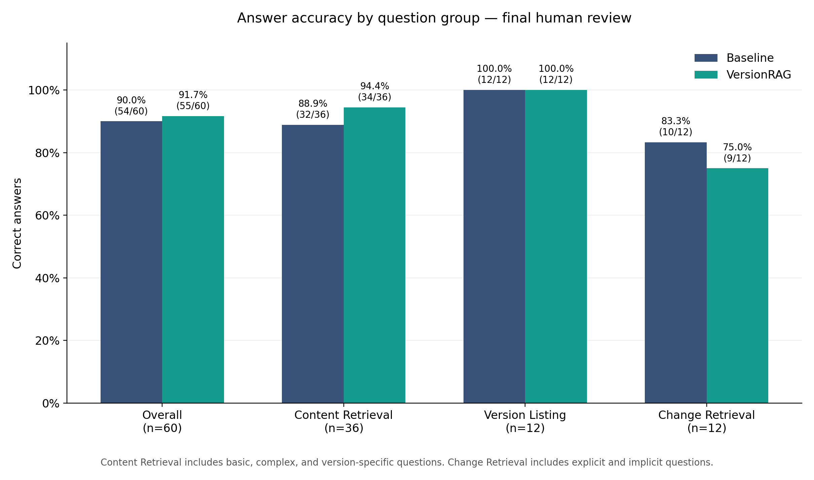

# Policy-aware RAG: Baseline vs VersionRAG

This project compares dense-retrieval RAG with an adapted version of VersionRAG on synthetic, versioned company policies. The dataset contains 12 policies, 28 full policy versions, six release-note files, and 60 evaluation questions generated with `gpt-4o-mini` and manually reviewed. The VersionRAG architecture and six question categories are based on the [VersionRAG paper](https://arxiv.org/pdf/2510.08109).

The question distribution is:

| Category | Questions |
| --- | ---: |
| Content retrieval | 12 |
| Complex content retrieval | 12 |
| Version-specific content retrieval | 12 |
| Version listing and inquiry | 12 |
| Explicit change retrieval | 6 |
| Implicit change retrieval | 6 |

This gives every policy one question in each of the first four categories. The remaining 12 change questions cover six policies. In total, 36 of 60 questions are version-sensitive

## Synthetic policy creation

1. `gpt-4o-mini` generates a complete v1 policy from a topic only
2. For each revision, the model proposes material changes in two sections; v3 avoids repeating the same rule change from v2
3. The script rewrites changed sections and copies unchanged text into a complete v2 or v3 policy. It keeps change notes outside the policy text
4. For each transition in P03, P06, and P09, it writes a short file under `dataset/release_notes/`. Explicit-change questions use these notes; implicit-change questions identify when a rule appeared by comparing policy versions without notes
5. The model then writes questions and expected answers from the relevant documents, checking evidence quotes and flagging mismatches for manual review. It saves the full review data in `questions_full_version.json` and the evaluation input in `questions_final.csv`

Each policy has an effective date and a `Supersedes` link in its header. When indexing, give both pipelines the same policy files and release notes. The current manually reviewed dataset is already in `dataset/`; running the generator with `--overwrite` there would replace it.

## Experimental setup

Both pipelines indexed the same 34 Markdown files. Baseline used dense retrieval from Milvus Lite; VersionRAG used Neo4j for version and change relationships alongside Milvus Lite for vector search. Both used `text-embedding-3-small` with 512 dimensions and `gpt-4o-mini` to generate answers. A separate `gpt-4.1` judge scored saved answers, followed by a complete manual review. The manual scores are the primary results below.

## VersionRAG adaptation

The cloned VersionRAG retrieval code was adapted for this policy dataset:

1. Normalized category, document, and version names are written back into search filters.
2. Explicit policy IDs such as `P06-v2` are resolved against the graph even if the query classifier omits them.
3. For content questions with an `as of` or `on` date and no explicit version ID, retrieval selects the latest version effective on that date. Dated content questions are routed to content retrieval instead of change retrieval.
4. Content retrieval excludes release notes; change retrieval can still use them.
5. Version listings include effective dates read from document headers.
6. Questions asking when or in which version a rule changed can retrieve change records from later versions.

These are dataset-specific retrieval adaptations, so the results should be described as an **adapted VersionRAG implementation**, not an unchanged run of the original repository.

## Results

Answer accuracy is the share of questions marked correct in the final manual review. The content group combines basic, complex, and version-specific content retrieval (36 questions); version listing contains 12 questions; and change retrieval combines explicit and implicit changes (12 questions).

| Approach | Overall [%] | Content Retrieval [%] | Version Listing [%] | Change Retrieval [%] |
| --- | ---: | ---: | ---: | ---: |
| Baseline | 90.00 (54/60) | 88.89 (32/36) | 100.00 (12/12) | 83.33 (10/12) |
| VersionRAG | 91.67 (55/60) | 94.44 (34/36) | 100.00 (12/12) | 75.00 (9/12) |

The two approaches differed by one correct answer overall. VersionRAG scored higher on content questions, while Baseline scored higher on change questions. The separate LLM judge scored Baseline 53/60 and VersionRAG 52/60. 

Additionaly, I calculated the agreement between the manual and LLM scores. It is 95% for each approach (Cohen's κ ≈ 0.74).

This is a small synthetic benchmark with one manual reviewer; the one-answer overall difference is descriptive rather than evidence of a general performance advantage.

Final artifacts: [questions](dataset/questions_final.csv), [answers](dataset/evaluation_final.csv), [manual scores](dataset/evaluation_human_final.csv), [LLM scores](dataset/evaluation_retest_v2_scored.csv), [summary table](dataset/final_accuracy_summary.csv), and the [plot script](src/plot_final_results.py).
